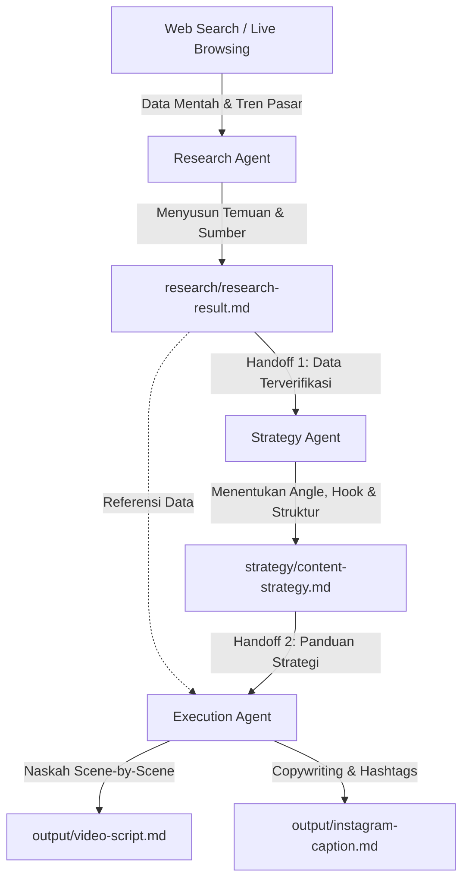

# AI Content Factory: Agentic AI Workflow untuk Content Creation

Dokumentasi resmi dan laporan arsitektur project **AI Content Factory** — sebuah pipeline otomatisasi berbasis *Agentic AI* yang mengubah hasil riset web dan tren pasar menjadi konten media sosial (Instagram Reels) yang siap dipublikasikan.

---

## Daftar Isi
1. [Project Overview](#1-project-overview)
2. [Problem Statement](#2-problem-statement)
3. [Project Goal](#3-project-goal)
4. [Why Agentic AI?](#4-why-agentic-ai)
5. [Workflow Architecture](#5-workflow-architecture)
6. [Research Agent](#6-research-agent)
7. [Strategy Agent](#7-strategy-agent)
8. [Execution Agent](#8-execution-agent)
9. [Handoff Mechanism](#9-handoff-mechanism)
10. [Tools and Ecosystems Used](#10-tools-and-ecosystems-used)
11. [Project Context / PROJECT.md](#11-project-context--projectmd)
12. [Execution Process](#12-execution-process)
13. [Final Output](#13-final-output)
14. [Screenshots](#14-screenshots)
15. [Challenges](#15-challenges)
16. [Lessons Learned](#16-lessons-learned)
17. [Future Improvements](#17-future-improvements)

---

## 1. Project Overview
**AI Content Factory** adalah sistem produksi konten multi-agen (*multi-agent autonomous workflow*) yang dirancang untuk memecahkan inefisiensi pembuatan konten edukasi karier. Dengan memisahkan tanggung jawab ke dalam tiga agen terspesialisasi (**Research Agent**, **Strategy Agent**, dan **Execution Agent**), sistem ini mampu menghasilkan naskah video pendek dan *caption* Instagram yang tajam, faktual, dan berbasis data tanpa risiko halusinasi informasi.

---

## 2. Problem Statement
Bagi kreator konten dan *job platform*, memproduksi konten media sosial yang berkualitas menghadapi beberapa hambatan utama:
- **Riset yang Memakan Waktu & Rentan Asumsi**: Menemukan data ketenagakerjaan kredibel dan tren rekrutmen terbaru memerlukan penelusuran manual yang panjang.
- **Halusinasi & Kurangnya Sumber Data**: Pembuatan konten menggunakan LLM konvensional satu tahap sering kali mengarang statistik fiktif tanpa atribusi sumber.
- **Kesenjangan antara Strategi dan Eksekusi**: Script sering kali melenceng dari persona audiens atau gagal menjawab *pain points* nyata pencari kerja.
- **Tingginya Angka Pengangguran Sarjana di Indonesia**: Berdasarkan data BPS, terdapat lebih dari 1 juta pengangguran terdidik akibat *skills mismatch* dan minimnya pemahaman praktis mengenai cara menyusun CV yang memikat HRD.

---

## 3. Project Goal
- Membangun *Agentic AI Workflow* yang modular, terukur, dan dapat diaudit di setiap tahapannya.
- Mengubah hasil riset aktual mengenai pasar kerja *fresh graduate* di Indonesia menjadi konten Instagram Reels berdurasi ~50–55 detik yang memiliki retensi tinggi.
- Memastikan bahwa setiap klaim dan tips penulisan CV didasarkan pada data survei rekruter resmi (BPS, Jobstreet, Glints, Astra) melalui mekanisme *handoff* yang ketat.

---

## 4. Why Agentic AI?
Pendekatan *single-prompt* LLM ("Buatkan saya video script tentang tips CV") memiliki kelemahan mendasar: model mencoba melakukan riset, strategi, *copywriting*, dan formatting sekaligus, yang berujung pada konten generik, klise, dan tanpa sumber jelas.

**Keunggulan Pendekatan Agentic AI:**
1. **Separation of Concerns (Pemisahan Peran)**: Setiap agen memiliki satu fokus spesifik (Riset mencari fakta, Strategi menentukan *angle*, Eksekusi menyusun kalimat).
2. **Deterministic Handoff (Serah Terima Berbasis Berkas)**: Data disimpan dalam berkas Markdown lokal sebagai *single source of truth*, bukan hanya tersimpan di memori *context window* sementara.
3. **No Hallucination**: Agen eksekusi dilarang membuat klaim di luar apa yang telah diverifikasi oleh agen riset.
4. **Human-in-the-Loop Friendly**: Pengguna dapat menginspeksi dan menyetujui output di setiap pos pemeriksaan sebelum agen berikutnya bekerja.

---

## 5. Workflow Architecture
Alur kerja sistem mengalir secara berurutan (*sequential pipeline*) dengan dokumen fisik sebagai gerbang *handoff*:



**Rantai Alur Kerja:**
`Web Search` → `Research Agent` → `research-result.md` → `Strategy Agent` → `content-strategy.md` → `Execution Agent` → `Final Content`

---

## 6. Research Agent
- **Peran**: Bertindak sebagai peneliti pasar dan pencari fakta independen.
- **Tugas**:
  - Melakukan penelusuran web mendalam mengenai dinamika dunia kerja *fresh graduate* di Indonesia.
  - Mengidentifikasi minimal 5 sumber kredibel.
  - Memetakan masalah psikologis (*quarter-life crisis*) dan tantangan teknis (skrining ATS, *skill mismatch*).
  - Merumuskan 5 potensi ide konten.
- **Aturan Ketat**: Dilarang membuat naskah atau caption pada tahap ini.
- **Output Berkas**: [research-result.md](file:///c:/Users/LENOVO/OneDrive/Gambar/Dokumen/AI%20Agent%20Workflow/AI-Content-Factory/research/research-result.md).

---

## 7. Strategy Agent
- **Peran**: Bertindak sebagai Content Strategist dan Creative Director.
- **Tugas**:
  - Mengambil data dari `research/research-result.md` tanpa melakukan riset ulang yang tidak perlu.
  - Memilih 1 ide konten terbaik dengan *engagement potential* tertinggi (terpilih: *Buka-Bukaan CV & Formula Dampak Terukur*).
  - Menetapkan profil target audiens, *pain points*, *content angle*, dan *tone of voice*.
  - Mengembangkan 3 alternatif *hook* interupsi pola.
  - Merancang arsitektur video berdurasi ~50–60 detik beserta strategi CTA ganda.
- **Aturan Ketat**: Dilarang menulis draf naskah lengkap atau caption final.
- **Output Berkas**: [content-strategy.md](file:///c:/Users/LENOVO/OneDrive/Gambar/Dokumen/AI%20Agent%20Workflow/AI-Content-Factory/strategy/content-strategy.md).

---

## 8. Execution Agent
- **Peran**: Bertindak sebagai Video Scriptwriter & Social Media Copywriter.
- **Tugas**:
  - Menerjemahkan panduan strategi dan fakta riset menjadi naskah video vertikal (9:16) berdurasi 50–55 detik.
  - Menyusun rincian *scene-by-scene* lengkap dengan instruksi visual presenter, *voiceover*, dan *On-Screen Text (OST)*.
  - Menulis *caption* Instagram yang ramah algoritma dengan struktur hierarki (Hook → Problem Context → Solution Formula → CTA → Hashtags).
- **Aturan Ketat**: Seluruh angka, fakta, dan perbandingan wajib bersumber dari berkas riset; tidak ada klaim baru yang dibuat-buat.
- **Output Berkas**:
  - [video-script.md](file:///c:/Users/LENOVO/OneDrive/Gambar/Dokumen/AI%20Agent%20Workflow/AI-Content-Factory/output/video-script.md)
  - [instagram-caption.md](file:///c:/Users/LENOVO/OneDrive/Gambar/Dokumen/AI%20Agent%20Workflow/AI-Content-Factory/output/instagram-caption.md)

---

## 9. Handoff Mechanism
Kunci keberhasilan alur kerja ini adalah **Artifact-Based Handoff**:
1. **Handoff 1 (Research → Strategy)**:
   - *Input*: `research/research-result.md`
   - *Validasi*: Keberadaan data statistik BPS (>1 juta pengangguran terdidik), fakta skrining HRD 6–10 detik dari Jobstreet/Glints, dan 5 ide konten.
   - *Hasil*: Strategy Agent hanya mengambil keputusan berdasarkan fakta yang tercatat di berkas ini.
2. **Handoff 2 (Strategy → Execution)**:
   - *Input*: `research/research-result.md` + `strategy/content-strategy.md`
   - *Validasi*: Kesesuaian hook terpilih, struktur 5 scene video, dan formula X-Y-Z (`Action Verb + Task + Metric`).
   - *Hasil*: Execution Agent menghasilkan aset publikasi final yang 100% konsisten dengan strategi.

---

## 10. Tools and Ecosystems Used
Project ini mendemonstrasikan integrasi lintas ekosistem (*multi-ecosystem interoperability*):
1. **Google Web Search Grounding API**: Digunakan oleh Research Agent untuk mengambil data riil dari portal ketenagakerjaan dan BPS secara langsung.
2. **Antigravity Agentic IDE & LLM Engine**: Menjalankan *reasoning*, pemisahan peran agen, dan orkestrasi perintah kerja.
3. **Local File System Workspace**: Penyimpanan berkas lokal berbasis Markdown sebagai memori persisten antar-agen.
4. **PowerShell / Windows Shell Execution**: Automasi pembuatan struktur folder dan verifikasi integritas berkas di sistem operasi Windows.

---

## 11. Project Context / PROJECT.md
File [PROJECT.md](file:///c:/Users/LENOVO/OneDrive/Gambar/Dokumen/AI%20Agent%20Workflow/AI-Content-Factory/PROJECT.md) berfungsi sebagai *Source of Truth* utama bagi seluruh workflow. Di dalamnya terdefinisi:
- **Project Name**: AI Content Factory
- **Goal**: Membangun workflow yang mengubah tren web menjadi konten sosial siap rilis.
- **Use Case**: Instagram Reels karier untuk *fresh graduate* di Indonesia.
- **Rules**: Dilarang mengarang data, wajib mencantumkan sumber, tidak boleh melompati fase alur kerja, dan semua output disimpan di workspace.
- **Success Criteria**: Minimal 2 tool/ekosistem digunakan, minimal 2 tahap handoff, data terverifikasi, dan keputusan konten tervalidasi.

---

## 12. Execution Process
Tahapan eksekusi yang telah diselesaikan di workspace:

```text
AI-Content-Factory/
├── PROJECT.md                      <- Master blueprint & aturan sistem
├── prompts/                        <- Direktori prompt agen
├── research/
│   └── research-result.md          <- Hasil riset dari 5 sumber kredibel
├── strategy/
│   └── content-strategy.md         <- Strategi angle, hook, dan struktur video
├── output/
│   ├── video-script.md             <- Script Instagram Reels 50-55 detik
│   └── instagram-caption.md        <- Copywriting caption dan hashtags
└── screenshots/                    <- Bukti visual eksekusi workspace
```

1. **Inisialisasi**: Pembentukan struktur folder dan pembuatan berkas master `PROJECT.md`.
2. **Fase Riset**: Pengumpulan fakta ketenagakerjaan dari BPS Sakernas, Glints, Jobstreet, Astra, dan Kerjago ke dalam `research/research-result.md`.
3. **Fase Strategi**: Pemilihan ide "Transformasi Kalimat CV Pasif ke Pencapaian Terukur", perumusan 3 opsi hook, dan struktur durasi ke dalam `strategy/content-strategy.md`.
4. **Fase Eksekusi**: Pembuatan naskah video berformat 9:16 di `output/video-script.md` dan teks pendukung di `output/instagram-caption.md`.

---

## 13. Final Output
Output final project ini siap diproduksi oleh kreator konten:
- **Video Script**: Menghadirkan hook visual 3 detik pertama dengan stempel *"REJECTED"*, visualisasi data skrining HRD 6–10 detik, demonstrasi formula `Action Verb + Task + Metric`, dan ajakan aksi *"SAVE video ini"*.
- **Instagram Caption**: Teks copywriting rapi dengan pemisah visual, data BPS dan Jobstreet, contoh *Before vs After*, *Call-To-Action* ganda, serta kumpulan *hashtags* tertarget.

---

## 14. Screenshots
Seluruh bukti visual pelaksanaan agen, pembentukan direktori, dan hasil *handoff* telah didokumentasikan di dalam folder `AI-Content-Factory/screenshots/`:

1. `01-projectaiagentworkflow-context.png`: Setup konteks awal project dan inisialisasi source of truth (PROJECT.md).
2. `02-projectworkflow-research.png`: Eksekusi Research Agent, live web search, dan pembuatan `research-result.md`.
3. `03-projectworkflow-strategycontext.png`: Handoff ke Strategy Agent dan perumusan dokumen `content-strategy.md`.
4. `04-projectworkflow-finalexecution.png`: Handoff ke Execution Agent serta produksi final script dan Instagram caption.

---

## 15. Challenges
1. **Penyaringan Informasi Padat ke Durasi Singkat**: Data statistik ketenagakerjaan BPS sangat komprehensif; tantangannya adalah menyederhanakan data tersebut menjadi wawasan 10 detik yang mudah dimengerti anak muda tanpa mendistorsi fakta.
2. **Disiplin Handoff Antar-Agen**: Memastikan agen pada tahap awal tidak "tergiur" langsung membuat copywriting, serta memastikan agen eksekusi tidak menambahkan opini pribadi yang tidak tercatat di berkas riset.
3. **Optimasi Hook untuk Platform Reels**: Menemukan sudut pandang kontras antara tingginya nilai akademis (IPK 3.7+) dengan realitas penolakan kerja akibat format penulisan CV.

---

## 16. Lessons Learned
- **Modularitas Meningkatkan Kualitas**: Ketika LLM hanya diminta fokus pada satu tugas (misalnya strategi tanpa memikirkan kata per kata naskah), kedalaman analisisnya meningkat drastis.
- **Berkas Lokal Sebagai State Store**: Menggunakan format Markdown sebagai media perantara antar-agen terbukti jauh lebih transparan, mudah dilacak (*auditable*), dan tahan terhadap batas memori percakapan.
- **Fakta Menghasilkan Engagement Lebih Kuat**: Konten edukasi karier yang didukung angka riil (seperti durasi 6–10 detik HRD) memberikan otoritas yang jauh lebih tinggi dibandingkan tips umum yang klise.

---

## 17. Future Improvements
1. **Automasi Pembuatan Prompt Template**: Membakukan instruksi peran agen ke dalam template berkas di folder `prompts/` agar dapat dijalankan secara instan untuk topik karier lainnya.
2. **Integrasi Voiceover & Visual Generatif**: Menghubungkan output teks ke model AI Text-to-Speech (TTS) dan generator grafis otomatis untuk membuat *storyboard* visual instan.
3. **Automated Publishing via API**: Menghubungkan agen eksekusi langsung ke Instagram Graph API untuk penjadwalan draf postingan secara otomatis setelah disetujui pengguna.
4. **Analisis Sentimen & Feedback Loop**: Menambahkan agen evaluasi pasca-unggah untuk memantau performa konten (komentar, share, save) dan memperbarui strategi konten berikutnya secara mandiri.
